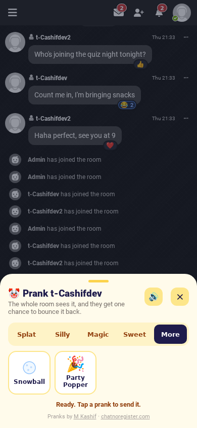
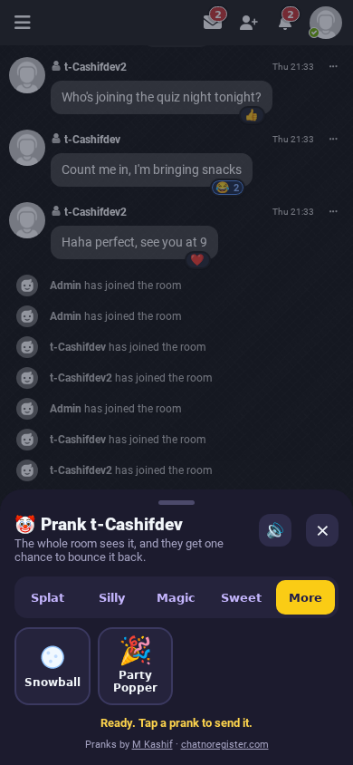
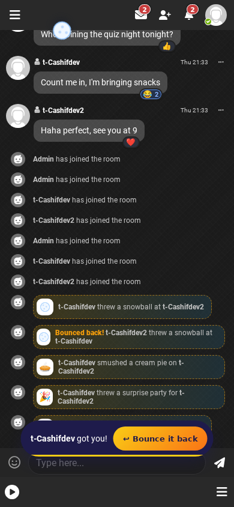
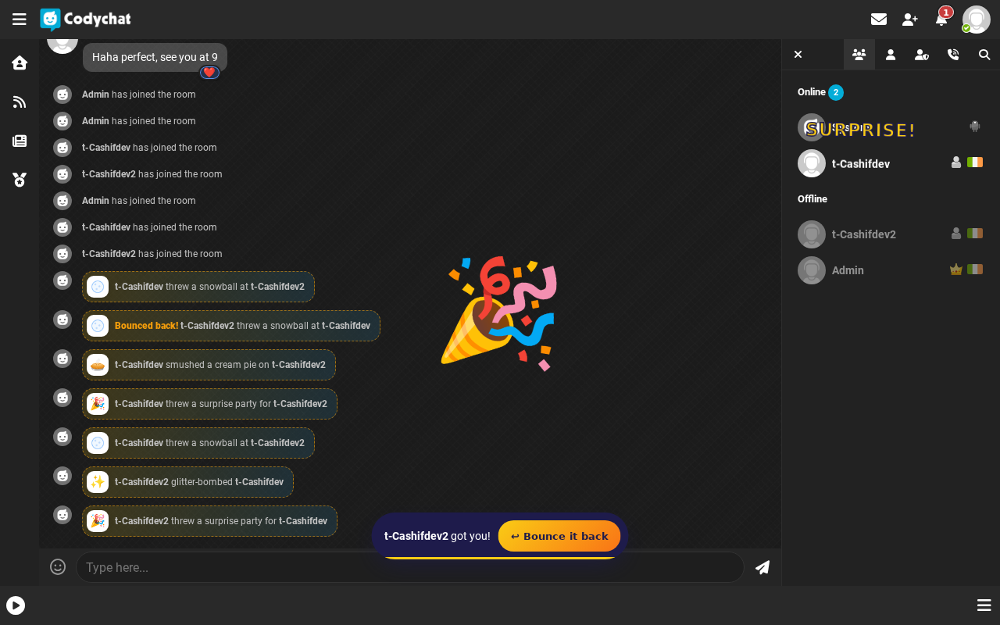
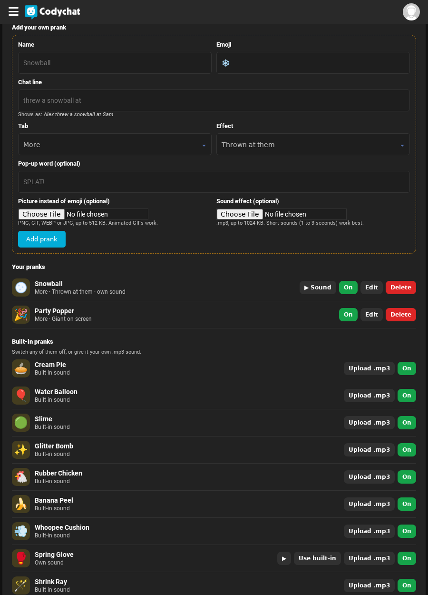
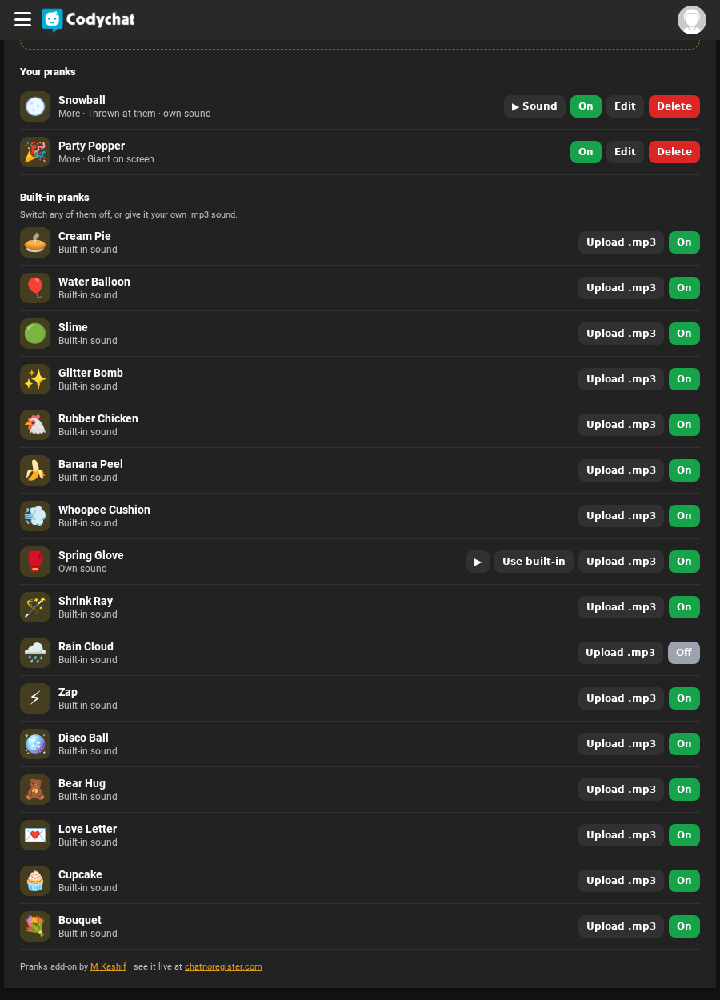

# 🤡 Pranks for Codychat 10.1

   

Throw a cream pie, a water balloon or a rubber chicken at a friend in chat. Everyone in the room watches it fly and land on their name, with sound. The person pranked gets one chance to **bounce it back**. As the chat owner, you can add your own pranks with your own emoji, pictures and **.mp3 sound effects**.

**Author:** [M Kashif](https://github.com/cashifdev) · **License:** MIT · **Tested on:** a clean Codychat 10.1 install

## Screenshots

| Prank picker (light) | Prank picker (dark) | Getting pranked |
|---|---|---|
|  |  |  |

| Your own prank, landing on desktop |
|---|
|  |

| Add your own pranks | Built-in pranks: own sound or switch off |
|---|---|
|  |  |

## Features
- **16 built-in pranks** in four tabs: Splat, Silly, Magic and Sweet. Each has its own animation (pies fly in an arc, slime drips, a rain cloud hangs over their name, a shrink ray makes it tiny) and a sound made in the browser
- **Bounce it back**: the person pranked gets 20 seconds to send it straight back, once, for free
- The whole room sees a prank line in chat, and the effect plays on the target's name
- **Add your own pranks** from the admin panel:
  - an emoji **or** a picture (PNG, GIF, WEBP or JPG, animated GIFs work)
  - your own chat line, like "threw a snowball at"
  - an optional pop-up word, like "SPLAT!"
  - an effect: thrown at them, pop and burst, rain down, giant on screen, or pop with a chat shake
  - an optional **.mp3 sound effect**
- **Your own .mp3 for any built-in prank**, or switch any built-in prank off
- **Light and dark** prank picker. Auto follows your chat theme
- Members can **mute** prank sounds from the picker, and the effects calm down for anyone with "reduce motion" on
- Cooldown between pranks, so nobody spams the room
- Bots can't be pranked, and pranks from people you ignore don't play for you
- **Shared hosting ready**: no WebSocket server and no Redis needed
- Optional credit line (on by default), which admins can turn off

## How it works
A prank is a small system line in the room chat. Codychat's own chat refresh brings it to everyone, so it works on any host. On a clean Codychat 10.1 install with no WebSocket server and no Redis, a prank showed on the other person's phone in about 3 seconds. Uploaded pictures and sounds are checked on upload, saved with random names in `addons/pranks/files/custom/`, and that folder can't run scripts.

## Requirements
- Codychat **10.1**
- PHP 8.0+ (tested on 8.3), MySQL/MariaDB
- For uploads: the folder `addons/pranks/files/custom` must be writable (755)

## Install
1. Download this repo and upload the `pranks` folder to `addons/` on your server, so you have `addons/pranks/`.
2. Open your **Admin panel → Addons** and press **Install** next to *pranks*.
3. Open its settings to add your own pranks and sounds. Done.

Members open someone's name menu and tap **Prank**.

## Admin settings
| Setting | What it does |
|---|---|
| Seconds between pranks | Cooldown per member (0 to 3600). A bounce-back is free |
| Picker theme | Auto, Light or Dark |
| Sound volume | 0 to 100, for built-in and uploaded sounds |
| Built-in sound effects | The browser-made splat, boing and chime sounds. Your own .mp3 sounds always play |
| Biggest sound file | Max .mp3 size in KB (100 to 5120). Your server's `upload_max_filesize` is shown next to it |
| Show credit link | A small "Pranks by M Kashif · chatnoregister.com" line in the picker. Keeping it on supports free add-ons |
| Add your own prank | Name, emoji or picture, chat line, tab, effect, pop-up word, .mp3 sound |
| Built-in pranks | Upload an .mp3 for any of them, go back to the built-in sound, or switch it off |

## Support
Tested on Codychat **10.1** only. Need it on Codychat 11 or an older version? Open an issue titled **[Paid install help](https://github.com/cashifdev/codychat-pranks/issues/new?template=paid_install_help.md)**.

Found a bug? [Open a bug report](https://github.com/cashifdev/codychat-pranks/issues/new?template=bug_report.md) with your Codychat version and what you see. See the [changelog](CHANGELOG.md) for what's new.

More free add-ons: [Smart Alerts](https://github.com/cashifdev/codychat-smart-alerts) · [Reactions](https://github.com/cashifdev/codychat-reactions) · [GPT Bot](https://github.com/cashifdev/codychat-gpt-bot)

⭐ If Pranks makes your chat more fun, star the repo and [follow me on GitHub](https://github.com/cashifdev) for more.

See it live at **[chatnoregister.com](https://chatnoregister.com)**.
